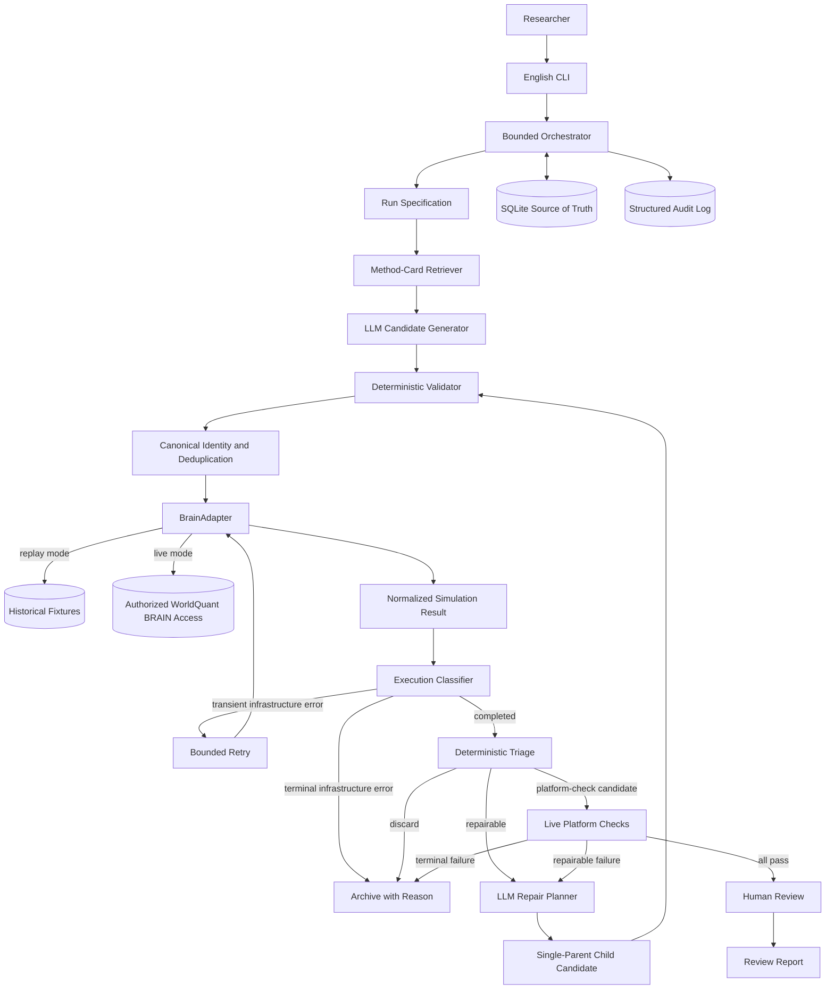

# Evidence-Gated Alpha Research Orchestrator

## Implementation specification

**Status:** Codex-ready MVP specification
**Implementation target:** a new, separate repository
**Working repository name:** `alpha-research-orchestrator`
**Language:** English for code, prompts, schemas, documentation, CLI output, and reports

This project is a clean-room-style reimplementation inspired by an architectural audit of CNHKMCP. It must not edit, import, or depend on the installed CNHKMCP package or `~/BrainMachine`. The old systems are read-only evidence sources.

The objective is not to maximize generated expressions. It is to run a bounded, auditable sequence of experiments in which every candidate, modification, simulation, failure, and decision can be reconstructed.

## 1. Product boundary

### MVP includes

- one dataset and one `Region × Universe × Delay` cell per run;
- a command-line interface;
- a deterministic Markdown method-card retriever;
- two LLM roles: candidate generation and failure-specific repair planning;
- structural validation against supplied field, operator, and setting metadata;
- canonical candidate identity and deduplication before simulation;
- a BRAIN adapter interface, a replay adapter, and an explicitly configured live adapter;
- bounded simulation retries and search limits;
- SQLite persistence with complete candidate lineage;
- deterministic routing gates and live platform-check recording;
- human review; no automatic submission;
- replay-based tests and an English Markdown run report.

### MVP excludes

- Web dashboard or Flask application;
- automatic Alpha submission;
- canonical genetic-algorithm machinery;
- multi-parent crossover;
- autonomous 24/7 background execution;
- a clone of all CNHKMCP MCP tools;
- public redistribution of private training transcripts, forum posts, credentials, or Alpha expressions;
- claims of out-of-sample robustness when the required data are unavailable.

## 2. System architecture



The retriever is ordinary deterministic software. The LLM is used only after relevant evidence has been retrieved and only where semantic judgment is required. The governing rule is: **the LLM proposes; deterministic code validates and authorizes.**

## 3. Technology choices

- Python 3.11 or later;
- `pyproject.toml` with an installable package and console script;
- Pydantic v2 for all boundary contracts;
- SQLAlchemy 2.x and Alembic for SQLite persistence and migrations;
- Typer for the CLI;
- HTTPX for network transport;
- the OpenAI Python client for configurable OpenAI-compatible LLM endpoints;
- PyYAML for method cards and versioned policies;
- pytest, pytest-cov, and respx for tests;
- Ruff for linting and formatting;
- no runtime dependency on pandas unless a report genuinely requires tabular operations.

Secrets must come from environment variables or an external user-owned session file. They must never be stored in SQLite, prompts, reports, logs, fixtures, or Git.

## 4. Repository layout

```text
alpha-research-orchestrator/
├── README.md
├── LICENSE
├── pyproject.toml
├── .env.example
├── alembic.ini
├── migrations/
├── policies/
│   ├── routing.v1.yaml
│   ├── limits.v1.yaml
│   └── error-taxonomy.v1.yaml
├── prompts/
│   ├── generator.v1.md
│   └── repair-planner.v1.md
├── method_cards/
│   ├── README.md
│   └── examples/
├── src/alpha_orchestrator/
│   ├── domain/
│   ├── orchestration/
│   ├── gates/
│   ├── knowledge/
│   ├── llm/
│   ├── adapters/
│   ├── storage/
│   ├── reporting/
│   └── cli/
└── tests/
    ├── unit/
    ├── integration/
    ├── replay/
    └── fixtures/
```

## 5. Core domain contracts

### RunSpecification

- `run_id`
- `dataset_id`
- `region`
- `universe`
- `delay`
- `data_type`: `MATRIX` or `VECTOR`
- `field_snapshot_id`
- `operator_snapshot_id`
- `setting_snapshot_id`
- `routing_policy_version`
- `limit_policy_version`
- `generator_prompt_version`
- `repair_prompt_version`
- `adapter_mode`: `replay` or `live`
- timestamps and status

Changing dataset, region, universe, delay, data type, or policy version creates a new run. Results from different research cells must not be silently combined.

### Candidate

- `candidate_id`
- `run_id`
- `parent_candidate_id`, nullable only for initial candidates;
- `generation_number`
- `expression`
- `canonical_expression`
- `settings_json`
- `candidate_fingerprint`
- `mechanism_claim`: a short candidate-specific prediction rationale;
- `source_method_card_ids`
- `changed_dimension`, required for children;
- `change_reason`, required for children;
- `status`
- timestamps

The mechanism claim belongs to the candidate, not to a general method card.

### SimulationAttempt

- `attempt_id`
- `candidate_id`
- `idempotency_key`
- `external_simulation_id`
- `external_alpha_id`
- `attempt_number`
- `status`
- `error_class`
- `error_message_redacted`
- normalized Sharpe, Fitness, Turnover and available platform metrics;
- raw-response artifact reference, not raw credentials;
- timestamps

### Decision

- `decision_id`
- `candidate_id`
- `gate_name`
- `gate_version`
- `outcome`
- `reason_codes`
- `metric_snapshot`
- `llm_request_id`, nullable;
- timestamp

### PromptVersion and LLMRequest

Every LLM request must record the prompt version, model, temperature, input hash, output hash, token usage when available, validation result, latency, and related run/candidate ID. Raw private corpus text must not be copied into the public report.

### MethodCard

A method card is reusable methodology, not a candidate hypothesis. Required fields:

- `card_id`, title, version and status: `draft`, `approved`, or `retired`;
- applicable failure codes and data types;
- prerequisites and diagnostic signals;
- allowed repair actions;
- prohibited or commonly ineffective actions;
- stop condition;
- evidence level: `official`, `training`, `forum_experience`, or `unverified`;
- source references with local document ID and section locator;
- reviewer and approval timestamp.

Only approved cards may influence a live run. Forum experience may guide an LLM proposal but must never become a hard platform rule without independent verification.

## 6. Candidate identity and deduplication

The MVP fingerprint is:

`SHA-256(canonical_expression + canonical_settings + region + universe + delay)`

Canonicalization must:

- normalize insignificant whitespace;
- normalize operator-name casing only when platform semantics permit it;
- serialize settings as sorted canonical JSON;
- preserve expression order and mathematical meaning;
- avoid claiming algebraic equivalence.

Before inserting a candidate, check both its fingerprint and an exact normalized-content hash. A duplicate links to the existing candidate and reuses its result; it does not create another pool entry or simulation request.

## 7. State machine

Candidate states:

`PROPOSED → VALIDATING → READY → QUEUED → SIMULATING → COMPLETED → TRIAGED`

Terminal or side states:

- `INVALID`
- `DUPLICATE`
- `RETRYABLE_ERROR`
- `TERMINAL_ERROR`
- `ARCHIVED`
- `READY_FOR_PLATFORM_CHECK`
- `READY_FOR_HUMAN_REVIEW`

Every transition must be transactional, append a Decision/Event record, and reject invalid source-to-target transitions.

## 8. Gates and exact placement

### G0 — Run contract

Runs only when all market-cell identifiers, snapshots, policy versions, prompts, and limits are frozen.

### G1 — Structural validity

Reject unknown fields/operators, incompatible MATRIX/VECTOR usage, unresolved placeholders, malformed expressions, and settings not present in the selected platform snapshot. One bounded LLM repair is allowed only when the validator provides a specific repairable error.

### G2 — Deduplication

Reuse an existing result when the fingerprint already exists. Never submit a duplicate simulation merely because it came from another generation.

### G3 — Execution validity

Classify authentication, authorization, verification, rate limit, timeout, connection, pending, cancellation, and terminal platform rejection separately. Infrastructure failures do not change the research-quality verdict.

### G4 — Early routing

The initial compatibility policy reproduces the audited package's permissive routing values so behavior can be compared:

- `strong`: average Sharpe at least `0.50` and average Fitness at least `0.30`;
- `weak`: Sharpe at least `0.25` or Fitness at least `0.15`;
- `discard`: average Turnover above `0.90` or no completed result.

These values allocate research effort. They are not trading evidence and are not platform-submission thresholds. They must live in versioned YAML, never inside orchestration code.

### G5 — Search control

Stop before generating more children when any configured limit is reached. The orchestrator must apply backpressure: it may not generate children while the pending queue is at its cap.

### G6 — Platform readiness

Use the live platform response for the exact market cell. Preserve `PASS`, `FAIL`, `WARNING`, `PENDING`, and transient `ERROR` separately. A local score must never overwrite the platform verdict.

### G7 — Human action

The MVP produces a review report but contains no automatic submit action.

## 9. Safe default limits

These are operational safety defaults, not optimized research parameters:

- initial candidates: 8;
- children per selected parent per generation: 2;
- maximum generations: 3;
- maximum distinct candidates: 50;
- maximum simulation-result rows: 100;
- maximum pending candidates: 20;
- maximum LLM requests: 30;
- transient retries per external request: 2;
- one structural-repair attempt per candidate;
- maximum wall-clock runtime: 6 hours;
- crossover: disabled;
- automatic submission: unavailable.

Limits are ceilings, not targets. Reaching a limit stops the run and records the exact reason.

## 10. LLM responsibilities

### CandidateGenerator

Inputs:

- frozen RunSpecification;
- field/operator/setting summaries;
- a bounded set of approved MethodCards;
- generator prompt version.

Output: at most the configured number of `CandidateProposal` objects containing a mechanism claim, expression, settings proposal, method-card references, and uncertainty. Output must validate against a Pydantic schema.

### RepairPlanner

Inputs:

- one parent candidate;
- completed metrics or a specific structural/platform failure;
- lineage and previous changed dimensions;
- retrieved approved MethodCards;
- remaining limits.

Output: `STOP` or at most two single-parent `RepairProposal` objects. Each proposal must name exactly one changed dimension, expected effect, source cards, revised expression/settings, and a falsification condition.

The LLM must not decide whether syntax is valid, classify HTTP errors, change limits, declare a platform pass, or submit an Alpha.

## 11. Methodology corpus pipeline

Raw Markdown remains in user-owned private directories and is never committed to the new repository.

The ingestion command must:

1. inventory Markdown files and assign stable source IDs;
2. record hash, title, source type and local locator;
3. exclude credentials, account data and complete Alpha expressions;
4. split documents into traceable sections;
5. extract draft MethodCards using an LLM or deterministic parser;
6. require human approval before cards become active;
7. retain paraphrased principles and citations, not copied articles or transcripts.

The initial known forum corpus is stored outside the project under the user's IQC corpus. The Bilibili transcript directory remains a configurable input and does not block the MVP.

Retrieval in the MVP is deterministic tag matching plus BM25-style lexical ranking. Embeddings and a vector database are explicitly deferred until retrieval evaluation demonstrates a need.

## 12. Adapter boundary

Define a `BrainAdapter` protocol with operations for:

- metadata snapshots: datasets, fields, operators and valid settings;
- create simulation with idempotency key;
- poll simulation;
- normalize results;
- request platform checks.

Implementations:

- `ReplayBrainAdapter`: mandatory for MVP and all automated tests;
- `LiveBrainAdapter`: disabled unless explicit credentials/session configuration is present;
- `FakeBrainAdapter`: deterministic unit-test fixture.

No test may contact WorldQuant. A working replay adapter is required before live work begins.

## 13. CLI contract

Required commands:

- `alpha-lab init`
- `alpha-lab corpus inventory <path>`
- `alpha-lab corpus extract <source-id>`
- `alpha-lab cards list`
- `alpha-lab cards approve <card-id>`
- `alpha-lab run create --dataset ... --region ... --universe ... --delay ...`
- `alpha-lab run execute <run-id> --adapter replay|live`
- `alpha-lab run status <run-id>`
- `alpha-lab run stop <run-id>`
- `alpha-lab run resume <run-id>`
- `alpha-lab platform-check <candidate-id>`
- `alpha-lab report <run-id>`

There is intentionally no `submit` command in the MVP.

## 14. Error taxonomy

At minimum:

- `AUTHENTICATION`
- `AUTHORIZATION`
- `HUMAN_VERIFICATION_REQUIRED`
- `RATE_LIMIT`
- `TIMEOUT`
- `NETWORK`
- `PENDING`
- `CANCELLED`
- `INVALID_EXPRESSION`
- `INVALID_FIELD`
- `INVALID_OPERATOR`
- `INVALID_SETTING`
- `PLATFORM_TERMINAL_FAILURE`
- `UNKNOWN`

Only authentication, verification, rate-limit, timeout, and network classes are retryable, and only within the configured limit. `UNKNOWN` is unresolved, not a research failure.

## 15. Required reports

Each run report must reconcile counts exactly:

`proposed = invalid + duplicate + queued/current + archived/current`

Report separately:

- proposed candidates;
- distinct candidate fingerprints;
- structural pass/fail;
- simulation requests, rows, completed results and infrastructure failures;
- deterministic gate outcomes;
- repair actions by changed dimension;
- platform-check outcomes;
- LLM requests and token usage;
- stop reason and unused limits;
- lineage for every surviving candidate.

Do not use the word `submittable` for a local score. Reserve `platform_all_pass` for a confirmed live response and `ready_for_human_review` for the local state.

## 16. Test and acceptance criteria

The MVP is complete only when all of the following pass:

1. Re-inserting the same normalized candidate 1,000 times produces one candidate record and zero duplicate simulation requests.
2. The pending queue never exceeds its configured cap.
3. Every non-root candidate has one valid parent, one changed dimension and one reason.
4. Authentication, verification, timeout and rate-limit errors never produce a research-quality failure.
5. Every external create request has a stable idempotency key and bounded retries.
6. All limits stop the run independently and persist an exact stop reason.
7. An interrupted replay run resumes without repeating completed simulations.
8. LLM output that violates its schema is rejected and cannot enter the candidate table.
9. Prompt, method-card and gate versions are reconstructable for every decision.
10. No credential-like fixture value appears in SQLite, logs, reports or Git history.
11. Platform `ERROR` and `PENDING` remain unresolved; they are not converted to `FAIL`.
12. The same replay fixture and policy versions produce the same deterministic gate decisions.
13. Core domain, gate, storage and orchestration tests reach at least 85% branch coverage.
14. `ruff check`, formatting checks, type checks and the complete pytest suite pass.

## 17. Historical regression fixtures

Create sanitized fixtures representing the observed failure classes without copying private expressions:

- repeated identical candidates across enhancement rounds;
- a pool whose producer outruns inspection;
- authentication-dominated simulation submission failures;
- missing idea and simulation artifacts;
- stale pool-size state;
- `CONCENTRATED_WEIGHT` and `LOW_COVERAGE` requiring targeted diagnosis;
- transient platform `ERROR` incorrectly treated as `FAIL`;
- legacy local `submittable` conflicting with zero platform-all-pass results.

The regression suite must prove the new design cannot recreate these failures.

## 18. Delivery milestones

### Milestone 1 — Offline auditable engine

Scaffold, domain models, migrations, state machine, policies, deduplication, replay adapter, CLI, structured logging, and tests. No LLM and no live network.

### Milestone 2 — Knowledge and LLM layer

Private corpus inventory, MethodCard workflow, retriever, versioned prompts, CandidateGenerator, RepairPlanner, schema validation, LLM request ledger, and replay evaluations.

### Milestone 3 — Authorized live adapter

Session handling, metadata snapshots, simulation create/poll/result normalization, platform checks, rate-limit handling, stop/resume, and a low-volume smoke test. No automatic submission.

### Milestone 4 — MCP interface

Expose only the stable, narrow service surface as MCP tools after the CLI and core engine are reliable. MCP is an interface milestone, not an MVP dependency.

### Milestone 5 — Portfolio presentation

Architecture README, one sanitized replay case study, test evidence, design tradeoffs, known limits, and a 60-second technical explanation. A dashboard remains optional.

## 19. Authorship and source policy

- New code must be authored in the new repository.
- Do not copy CNHKMCP implementation code or prompts into the clean-room project.
- General architecture patterns may be reimplemented and acknowledged.
- Raw training/forum material remains private and is never redistributed.
- Method cards must be paraphrased, source-linked and human-reviewed.
- No proprietary Alpha expression is included in fixtures, prompts, documentation or Git.
- The README must distinguish architectural inspiration, user-authored design decisions, and independently implemented code.

## 20. Definition of success

The system succeeds when a second researcher can reconstruct:

1. the frozen run specification;
2. why every candidate was proposed;
3. whether it was structurally valid and unique;
4. every simulation attempt and infrastructure failure;
5. the policy and evidence behind every decision;
6. every parent-child modification;
7. why the search stopped;
8. the live platform-check result, when one was requested;
9. the human review outcome.

Candidate volume, by itself, is not a success metric.
