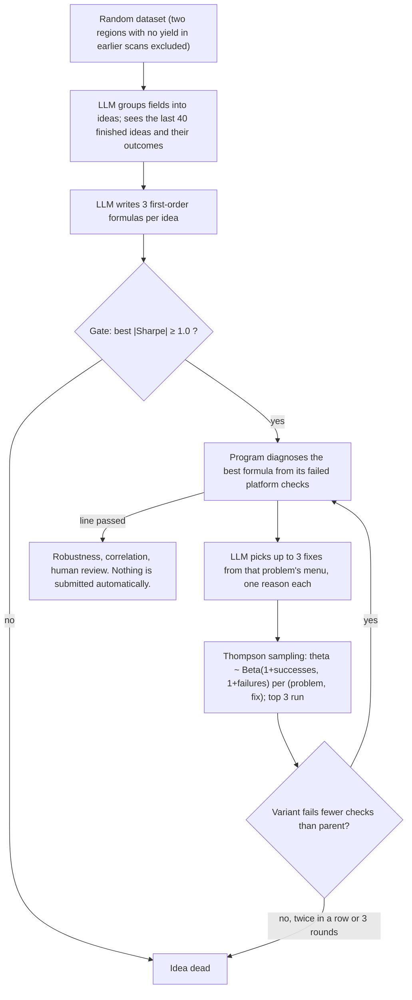
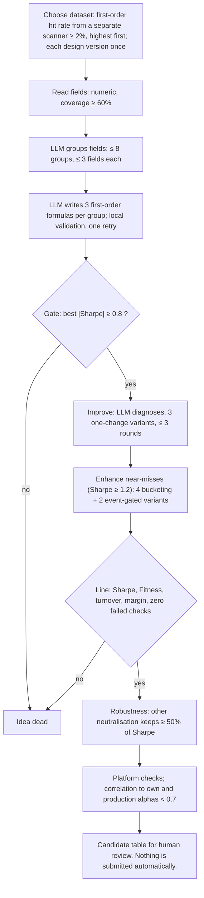
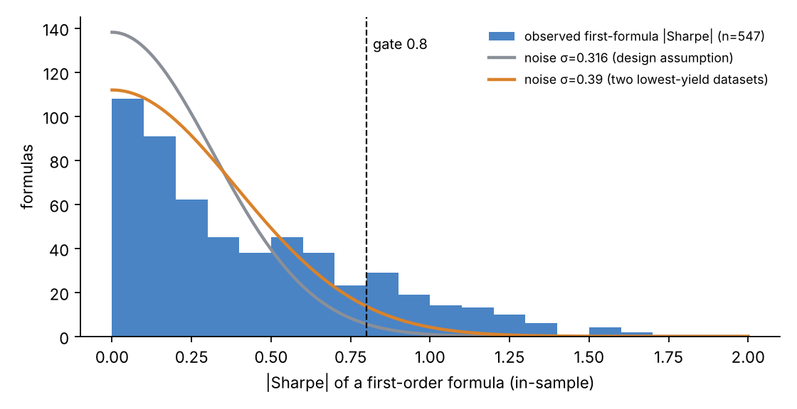
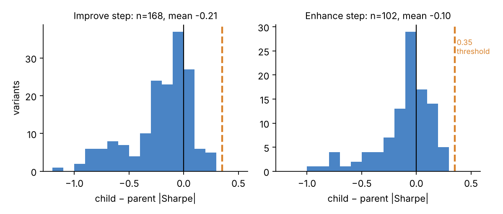
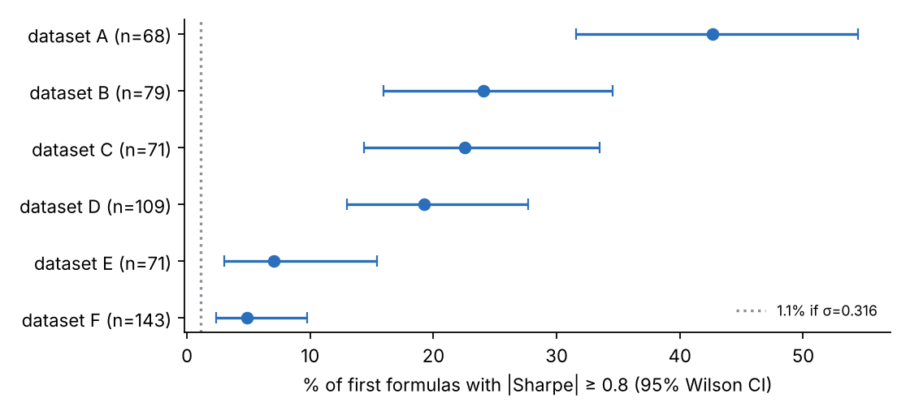
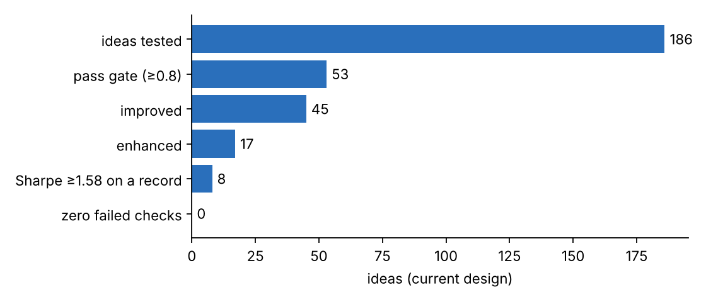

# Alpha Factory: an LLM-guided search for tradable signals, run as a budgeted statistical experiment

Alpha Factory asks a language model to propose candidate trading formulas from a dataset's field descriptions, then lets deterministic software decide which proposals deserve backtest budget. Every backtest, decision and stop is recorded in a ledger, so the search itself can be audited and its design hypotheses tested against its own data.

## Current performance

**The current design, v7, went live on 2026-11-03.** In its first 3.3 days it produced 10 formulas from 9 ideas that clear every in-backtest platform check and the Sharpe, Fitness, turnover and margin lines. The previous design, v6, produced none in 1,039 backtests.

| | v6 (2026-10-16 to 11-02) | v7 (2026-11-03 to 11-06) |
|---|---:|---:|
| Backtests completed | 1,039 | **1,992** |
| Daily quota used¹ | 17% | **59.7%** |
| Formulas with Sharpe ≥ 1.58 | 61 | **214** |
| …that also clear every in-backtest check and all four lines | **0** | **10** (9 ideas, best Sharpe 1.89) |
| Refinement attempts that improved on their parent | 0 of 206 (free-form LLM rewrites, 0.35 Sharpe rule) | 48 of 408 (menu fixes; success = fewer failed checks) |
| Submitted to the platform | 0 | 0 |

¹ v6: share of the daily limit on its 5 active allocation days; v7: share of the daily limit over its 3.3 calendar days.

v7 idea funnel (528 ideas finished in the week to 2026-11-06):

| Step | Ideas | Pass rate |
|---|---:|---:|
| Ideas with ≥ 1 valid backtest | 528 | |
| Best first formula \|Sharpe\| ≥ 1.0 | 115 | 21.8% |
| Any backtest with Sharpe ≥ 1.2 | 97 | 84.3% |
| Sharpe, Fitness, turnover and margin lines all met | 28 | 28.9% |
| Every in-backtest platform check passed | 9 | 32.1% |
| Submission check passed, in the human pick-list | 0 | 0% |

**Known issue.** The last step is 0 of 9 because of a defect, not the formulas: 7 of the 9 ideas reached the submission check on a day the account's daily submission limit was already used, and the factory recorded that as a permanent failure. The fix and its test are the plan for the week of 2026-11-09 ([report](CHANGELOG.md#2026-11-06--weekly-report-design-v7)).

All figures are in-sample and come from the private ledger; formula text and record-level data are not published.

## Weekly reports

Every Friday the factory's own ledger produces a report: quota use, the idea funnel and its weakest step, the success rate of each refinement fix, cost, errors, and one proposed change with the number it rests on and how next week's data will test it. Full entries are in the [changelog](CHANGELOG.md).

| Week ending | Design | Backtests | In pick-list | Main finding | Change proposed |
|---|---|---:|---:|---|---|
| [2026-11-06](CHANGELOG.md#2026-11-06--weekly-report-design-v7) | v7 | 2,214 | 0 | 7 of 9 ideas at the submission check were blocked only by the account's daily submission limit, recorded as a permanent failure | Treat that check as "retry later" and re-check the held formulas |

Earlier dated entries: [2026-10-31 offline audit of the LLM steps](CHANGELOG.md#2026-10-31-evening-offline-audit-of-the-llm-touchpoints), [2026-10-31 ledger re-derivation](CHANGELOG.md#2026-10-31).

## How it works (v7)

v7 keeps the ledger, budgets, gates and human submission gate of v6 and changes four things. The refinement loop follows the analysis-plus-bandit structure of R&D-Agent(Q) ([NeurIPS 2025](https://arxiv.org/abs/2505.15155)): a diagnosis of each experiment, then a Thompson-sampling scheduler choosing the next action. Here the actions are refinement types rather than factor-versus-model steps, and the budget is a hard daily quota.



| Change | Evidence from v6 | v7 rule |
|---|---|---|
| Refinement | LLM free-form variants: 0 of 206 gained 0.35; mean −0.215 | The program states the problem; the LLM only chooses among 12 fixed structural or setting fixes; the program applies them |
| What to fix | All 61 formulas with Sharpe ≥ 1.58 failed a robustness check | Diagnosis order: turnover, concentration, Sharpe, Fitness, sub-period stability, sub-universe; each has its own menu (bucketed comparison, event-gated trading, smoothing, neutralisation, decay) |
| Budget across fixes | v6 applied a fixed set of six wrappers to every near-miss | Thompson sampling over (problem, fix); success = fewer failed checks than the parent. Past rows that match a menu fix seed the counts |
| Ideas | Each idea was generated without seeing earlier ones | Idea generation sees the last 40 finished ideas (meaning, best Sharpe, why it stopped), no formula text |
| Dataset order | Ranked by a separate scanner's hit rate, which assumes datasets the scanner found empty are empty | Uniformly random among unworked datasets; a dataset without signal costs about 24 backtests before it closes |
| Throughput | 2 ideas in flight used 17% of the quota | 6 ideas in flight |

Each Friday the program writes a report from the ledger: quota use, the idea funnel, the step with the lowest pass rate, the success rate of every fix, and cost per submittable idea. See [Weekly reports](#weekly-reports).

## Background, v6 design and evidence

The sections that follow give the problem statement, the v6 design and the ledger evidence that motivated v7.

1. [Problem](#1-problem)
2. [v6 design](#2-v6-design-2026-10-16-to-2026-11-03)
3. [Statistical design](#3-statistical-design-v6)
4. [Parameters](#4-parameters)
5. [Assumptions](#5-assumptions)
6. [Evidence](#6-evidence)
7. [Results to date (v6)](#7-results-to-date-v6-as-of-2026-10-31)
8. [Limitations and open questions](#8-limitations-and-open-questions)
9. [Repository and reproduction](#9-repository-and-reproduction)

**Terms used below.** *Idea*: a group of at most three related data fields plus an economic reason; the LLM writes several formulas per idea. *Formula*: one expression combining fields with operators. *Backtest*: one in-sample simulation of a formula (about ten years of daily data). *Sharpe*: annualised mean-over-volatility of that backtest's daily returns. *Gate*: a threshold on first-formula Sharpe below which an idea is dropped. *Line*: the full acceptance standard (Section 3.5). *Platform checks*: robustness tests the backtest platform runs on each result. *Allocation day*: the platform's quota day, which resets at 21:00 Pacific.

## 1. Problem

**Setting.** A research platform grants a fixed simulation quota per day (1,000 for this factory). A dataset offers hundreds to thousands of fields. The universe of formulas built from them is far larger than the quota, and the backtest that scores a formula is noisy and in-sample.

**Decision problem.** Choose which dataset to open, which formulas to test, and when to stop each path, so that the expected number of formulas meeting the acceptance line per unit of quota is as large as possible, while keeping the false-discovery risk of the accepted set controlled.

**Why this is a statistics problem.** Three features make it one.

1. *Selection.* The reported Sharpe of the best of $n$ trials is biased upward. If a formula with no information has Sharpe $S\sim N(0,\sigma^2)$, the expected best absolute value after $n$ independent tries is about $\sigma\sqrt{2\ln n}$. Any rule that picks the best and then reports it must be judged against this "luck bar".
2. *Sequential decisions.* Each backtest result changes what to test next, so thresholds act as stopping rules whose error rates must be computed, not assumed.
3. *Small effects, expensive samples.* One sample costs one unit of quota; the effect of an improvement step is a few tenths of a Sharpe unit, comparable to the noise.

**What the LLM is and is not for.** The LLM supplies hypotheses and variants. It never decides what runs, what stops, or what is submitted. Deterministic code owns validation, budgets, thresholds and the human submission gate. Whether the LLM adds value over undirected search is *not* established (Section 8).

## 2. v6 design (2026-10-16 to 2026-11-03)



Operational rules that matter for the statistics:

- **Quota.** At most 1,000 simulations per allocation day, counted when a request is created, including pending and unknown ones. Only a confirmed rejection releases a reservation.
- **One unknown stops everything.** If a batch's outcome cannot be reconciled, the factory pauses until a human resolves it, rather than re-sending the work.
- **Dataset budget.** At most 1,000 simulations per dataset, at most 2 ideas in flight, and a dataset closes after two consecutive failures of the LLM to produce a valid new idea.
- **Human gate.** Submission requires an explicit approval command; at most 4 submissions per day and 8 per dataset.

## 3. Statistical design (v6)

### 3.1 First-formula gate

An idea is tested with $k=3$ first-order formulas. The gate drops the idea unless $\max_i |S_i| \ge g$ with $g=0.8$. The design assumed a no-information formula has $S\sim N(0,\sigma^2)$ with $\sigma=1/\sqrt{10}=0.316$ (ten years of daily data). Then

$$p_1=P(|S|\ge g)=2\bigl(1-\Phi(g/\sigma)\bigr)=1.1\%,\qquad P(\text{best of }k\ge g)=1-(1-p_1)^k=3.4\%.$$

The gate is the "5% luck line" of three noise formulas ($g\approx 0.76$ rounded up to 0.8). The same calculation at larger $\sigma$ is in Section 6, E1.

### 3.2 Improvement step

For a parent with Sharpe $S_p$, the LLM diagnoses the weakest property (no signal, reversed direction, turnover, concentration, low fitness) and proposes $m=3$ variants, each a single change. A variant with Sharpe $S_v$ replaces the parent only if

$$S_v \ge S_p + \delta,\qquad \delta=0.35,$$

because the best of three correlated variants (pairwise correlation 0.7 to 0.87) can exceed the parent by 0.34 to 0.50 by chance alone. A parent with $S_p\ge 1.2$ (a near-miss) keeps trying for the full three rounds and is replaced by any better variant. Otherwise a round with no replacement ends the idea, after at most three rounds.

### 3.3 Enhancement

For an idea that finishes improvement as a near-miss without passing the line, six structural variants are added: four that compare the formula within turnover or size buckets (group z-score or group neutralisation over deciles of traded value or market cap) and two that trade only under an event condition. These structures were chosen from the sister scanner project, where they passed the three Sharpe, Fitness and turnover lines at the highest rates.

### 3.4 Dataset allocation and stopping

Datasets are taken in descending order of the scanner's first-order hit rate (above 2%). A dataset is scouted with 8 idea groups; if none passes the gate it is closed as signal-free, otherwise up to 10 more groups are added until its 1,000-simulation budget is spent.

### 3.5 The acceptance line

A formula is accepted for review only if all hold: $S\ge 1.58$ (2.08 in one region), Fitness $\ge 1$, turnover between 1% and 70%, margin above a regional floor (5, 15 or 20 basis points), **and no failed platform check**. A $|S|>3$ result is treated as an artefact and not pursued.

### 3.6 Budget identities

Let $D$ be the daily cap, $u_t$ the simulations launched on allocation day $t$, and $B_d$ the per-dataset cap. The constraints are $u_t\le D=1000$ and $\sum_t u_t^{(d)}\le B_d=1000$. Utilisation in the current design is $\sum u_t/(D\cdot T)$.

### 3.7 Worked example: one idea from start to finish

Dataset C (fundamental-type fields, one region). The idea groups fields around a cash-flow quantity per share. Numbers are in-sample Sharpe.

| Step | What happened | Result |
|---|---|---|
| 1. First formulas | Level rank; quarterly change rank; rank within industry | 1.40, 1.22, 1.59 |
| 2. Gate | Best 1.59 ≥ 0.8, so the idea continues | pass |
| 3. Improve, round 1 | Three one-change variants of the 1.59 formula | 1.03, 1.54, 1.45 |
| 4. Round 2 | Three more | 0.68, 0.33, 1.35 |
| 5. Round 3 | Three more | 1.43, 0.92, 1.55 |
| 6. Replacement rule | No variant reaches 1.59 + 0.35 = 1.94, and none exceeds 1.59 | parent kept |
| 7. Near-miss (1.59 ≥ 1.2) | Enhancement: four bucketing variants of the 1.59 formula, then two event-gated variants of the best result | 1.52, 1.53, **1.83**, 1.82; then 1.73, 1.64 |
| 8. Line check on 1.83 | Fitness 1.08 ✓, turnover 3.4% ✓, margin 25.6 bp ✓ | passes four of five conditions |
| 9. Platform checks on 1.83 | Sub-universe Sharpe **fails**; in-sample sub-period ("ladder") Sharpe **fails** | not accepted |
| 10. Verdict | The idea is closed: no formula passed the line | dead |

What the example shows: the nine improvement variants added nothing over the first formula; the one gain (+0.24) came from enhancement; and the final blocker is a robustness property, not Sharpe. Section 6 tests whether this pattern is typical.

## 4. Parameters

| Parameter | Value | Source | Reason |
|---|---|---|---|
| Daily quota | 1,000 simulations | Platform allocation | Fixed; scanner has its own 4,000 |
| Per-dataset budget | 1,000 | Design | Stops one dataset absorbing the quota |
| Ideas per dataset scout | 8 groups, ≤ 3 fields each | Design (10/15) | 0.8⁸ ≈ 17% chance of wrongly dropping a real dataset if 20% of groups pass |
| First formulas per idea | 3 | Design | 100 simulations over 12 per idea ≈ 8 ideas |
| Operators per formula | ≤ 5 at start, ≤ 8 after three changes | Downstream program limit | Keeps formulas eligible |
| Noise σ | 0.316 | $1/\sqrt{10}$; scanner no-signal datasets measured 0.25 to 0.33 | Gate calibration (revisited in E1) |
| Gate | 0.8 | 5% luck line of 3 noise formulas | Budget protection |
| Improvement threshold δ | 0.35 | Correlated-variant noise 0.34 to 0.50 | Avoid accepting noise as improvement |
| Variants per round, rounds | 3, ≤ 3 | Design | At most 12 simulations per idea |
| Near-miss | Sharpe ≥ 1.2 | Design | One step from the line |
| Enhancement | 4 bucketing + 2 event-gated | Scanner second and third stages | Highest pass rates there |
| Line | S ≥ 1.58 (2.08 one region), Fitness ≥ 1, turnover 1% to 70%, margin 5 / 15 / 20 bp | Platform submission rules | Acceptance |
| Robustness | other neutralisation keeps ≥ 50% of Sharpe | Research group guidance | Guards against one setting |
| Correlation | < 0.7 to own and production alphas | Platform rule | Diversification |
| Artefact | \|S\| > 3 | Owner decision | Treated as error, not found |
| Field coverage | ≥ 60% | Platform guidance | Avoid sparse inputs |
| Quota rollover | 21:00 Pacific | Platform | |
| Submissions | ≤ 4 per day, ≤ 8 per dataset | Rules | |
| LLM | Temperature 0.4, 4,096 tokens, ≤ 1,000 calls per day | Design | Cost and variety |

## 5. Assumptions

Status: **Supported**, **Challenged** (data disagree), **Not supported**, **Untested**.

| # | Assumption | Relied on by | If wrong | How tested | Evidence | Status |
|---|---|---|---|---|---|---|
| A1 | No-information first formulas have \|S\| ~ half-normal with σ = 0.316 | Gate 0.8 | Gate passes more noise ideas | E1 | Observed SD 0.52; 0.37 and 0.39 in the two lowest-yield datasets; 4.9% and 7.0% of their formulas exceed 0.8 vs 1.1% predicted | **Challenged** |
| A2 | The three first formulas are independent | Best-of-3 false-positive rate | Rate is lower than computed | Not yet | Formulas of one idea share fields | Untested |
| A3 | Datasets differ in signal content | Dataset ordering | Selection is wasted effort | E5 | χ² = 53.6, 5 df, p = 2.5×10⁻¹⁰ | **Supported** |
| A4 | The scanner's first-order hit rate predicts yield here | Which dataset opens next | Order is arbitrary | E5 | Only 4 datasets overlap; rank correlation 0.4, uninformative | Untested |
| A5 | LLM diagnosis improves formulas | Improve step | 21% of backtests (168 of 817) buy nothing | E3 | 0 of 168 variants gain ≥ 0.35; mean change −0.21 (95% CI −0.26 to −0.17); no control arm | **Not supported** |
| A6 | Gains below 0.35 are noise | δ = 0.35 | Real gains discarded | E3 | Largest gain observed 0.30, so the rule never triggered | Untested |
| A7 | Scanner-validated structures transfer | Enhancement | Six simulations per near-miss | E4 | Mean change −0.10 (CI −0.15 to −0.05); 36 of 102 up; the best result overall is an enhanced formula | Mixed |
| A8 | In-sample Sharpe ≥ 1.58 with clean checks predicts out-of-sample value | The line | Accepted alphas fail live | None possible yet | No accepted alpha; no out-of-sample test | Untested |
| A9 | "No accepted idea" means "dataset has no signal" | Dataset closure label | Datasets mislabelled | E6 | A dataset with 22.5% gate-level formulas and 7 formulas at Sharpe 1.58 to 1.83 is labelled noise | **Challenged** |
| A10 | Quota is the binding constraint | Budget rules | Effort goes to the wrong limit | E9 | Peak 321 of 1,000 per day; 17% of capacity over the 5 active days | **Challenged** |
| A11 | Sub-universe and sub-period failures can be fixed by one-change variants | Improve, enhance | Near-misses stay near | E7 | 16 of 22 high-Sharpe formulas fail the sub-period check, 11 the sub-universe check; none fixed | Not supported so far |
| A12 | Results from earlier design versions are comparable | Pooling | Mixed populations | Excluded | Only the current design is pooled; 3,033 earlier records are excluded | Handled by exclusion |
| A13 | Mirroring a negative formula is valid | Gate uses \|S\| | Wrong sign in constrained regions | Rule | 35% of first Sharpes are negative; one region excluded | Assumed |
| A14 | LLM-proposed formulas are not contaminated by memory of historical returns | All results | Optimistic in-sample Sharpe | None | LLM training data overlaps the backtest period | Untested |

## 6. Evidence

All figures use the current design (2026-10-16 onward, 547 first-order formulas, 186 ideas). Record-level data are private.

### E1. The gate's noise model



| Assumed σ | Source | Per-formula P(\|S\| ≥ 0.8) | Best of 3 |
|---:|---|---:|---:|
| 0.316 | Design assumption | 1.1% | 3.4% |
| 0.39 | Two lowest-yield datasets | 4.0% | 11.6% |
| 0.52 | All first formulas | 12.4% | 32.8% |

The observed histogram has fewer values near zero and more in the tail than a zero-mean noise model of any width. Part of the excess is real signal; part is common-factor exposure that makes a no-skill formula's Sharpe differ from zero. The data cannot separate the two, so the gate's false-positive rate is somewhere between 3.4% and 33%, not 3.4%.

### E2. Gate sensitivity

| Gate | 0.6 | 0.7 | 0.8 | 0.9 | 1.0 | 1.2 |
|---|---:|---:|---:|---:|---:|---:|
| Ideas passing (of 186) | 91 | 69 | **53** | 41 | 30 | 14 |

| Best first-formula band | Ideas | Later reached Sharpe ≥ 1.2 | Later reached ≥ 1.58 |
|---|---:|---:|---:|
| below 0.6 | 95 | not tested | not tested |
| 0.6 to 0.8 | 38 | not tested | not tested |
| 0.8 to 1.0 | 23 | 0 | 0 |
| 1.0 to 1.2 | 16 | 3 | 1 |
| 1.2 and above | 14 | 14 | 7 |

The 23 ideas that passed the gate with a best first formula below 1.0 each cost up to 12 simulations in improvement, and none reached 1.2. Ideas below the gate were never tested further, so the gate's false-negative rate is unmeasured.

### E3. Improvement step



168 variants from 45 ideas: mean change in \|Sharpe\| **−0.21** (bootstrap 95% CI −0.26 to −0.17); 38 above the parent (23%); maximum gain 0.30; none reached 0.35. The parent is the best of three first formulas, so regression to the mean predicts a decline even for a useless step. With no control arm (variants drawn without LLM diagnosis), the data say only that the step has not been shown to help.

### E4. Enhancement step

102 variants from 17 ideas: mean change **−0.10** (CI −0.15 to −0.05); 36 up; maximum gain 0.27. The highest Sharpe in the ledger (1.83) is an enhanced variant of a 1.59 parent, so the step produces the top of the distribution and a negative average.

### E5. Datasets differ



Six datasets with at least 20 first formulas: 4.9% to 42.6% of formulas exceed 0.8, all above the 1.1% the design predicts. Homogeneity is rejected (χ² = 53.6, 5 df, p = 2.5×10⁻¹⁰). Dataset choice matters. Whether the scanner's hit rate predicts these rates cannot be tested yet: only 4 datasets have both measurements.

### E6. Dataset closure label

Every dataset closed so far is labelled "noise", because "noise" means no idea reached the full line. One dataset had 22.5% of first formulas above the gate and 7 formulas at Sharpe 1.58 to 1.83 yet carries the same label as datasets with 5% hit rates.

### E7. What blocks the best formulas



Of 22 formulas with Sharpe ≥ 1.58, failed checks: sub-period 16; Fitness 14; sub-universe 11; turnover 10; regional sub-sample 8. Eight pass the Sharpe, Fitness, turnover and margin conditions and fail only platform checks. Across all 817 completed backtests, 58 have no failed check, with Sharpe 1.00 to 1.50.

### E8. The luck bar

After $n=547$ first formulas, pure noise is expected to reach a best $|S|$ of $\sigma\sqrt{2\ln n}$: 1.12 at σ = 0.316, 1.38 at 0.39, 1.85 at 0.52. The best first-order value is 1.61. The best first-order value sits between the bars for σ = 0.39 and σ = 0.52, so on its own it is not distinguishable from selection luck.

### E9. Budget use

829 backtests over 5 active allocation days against a capacity of 5,000 (17%); peak 321 in a day. Quota was not the limit on active days; the ledger does not record why other days were idle.

## 7. Results to date (v6, as of 2026-10-31)

| | Completed | Notes |
|---|---:|---|
| Earlier designs (probe/survey, four ideas per dataset, first LLM loop) | 2,988 | Not pooled; design changed three times |
| Current design | 817 | 186 ideas, 7 datasets |
| In flight or quarantined | 12 | 6 quarantined with unknown outcome; 6 in flight at the last record |
| Formulas with Sharpe ≥ 1.0 / 1.2 / 1.58 | 218 / 143 / 22 | In-sample |
| Accepted for human review | 0 | |
| Submitted | 0 | |

LLM usage across the ledger: 765 calls, about ¥26.

## 8. Limitations and open questions

- **No control arm.** There is no non-LLM search with the same budget, so the LLM's contribution is unmeasured. The sister scanner (template search, same platform) is the closest control but uses different formula families.
- **In-sample only.** No out-of-sample or live performance exists for any formula.
- **Selection and multiplicity.** Sharpe values of the best formulas must be read against the luck bar (E8); no multiple-testing correction is applied to the reported maxima.
- **One window, one platform, one operator.** The current design has 5 active days of data.
- **One batch has an unresolved outcome.** Six tasks remain quarantined; no replacement was sent, and the platform quota counter was not read directly.
- **Dataset label is misleading** (E6) and the σ assumption is contradicted (E1). Neither has been changed.
- **Public code lags the private working system.** Some current changes are not in this repository.

Planned tests, each to be recorded in the [changelog](CHANGELOG.md): (1) a control arm of undirected one-change variants against LLM-diagnosed ones; (2) re-estimating σ per dataset family and replaying the gate at the re-estimated value; (3) testing whether gate false negatives exist by running a random sample of gated-out ideas; (4) separating "no accepted idea" from "no signal" in the dataset label; (5) a sub-period-aware variant step aimed at the dominant failed check.

## 9. Repository and reproduction

```
src/alpha_orchestrator/   ledger, scheduler, validation, LLM client, factory engine
tests/                    unit and integration tests (offline)
docs/                     architecture, design trade-offs, test evidence, progress log
scripts/                  offline demo and progress export
```

Reproduce the offline demo and the test suite without credentials; see [test evidence](docs/TEST_EVIDENCE.md) and the [sanitised replay](docs/case-studies/sanitized-replay.md). Record-level results and formula text are not published: they come from a licensed platform. Aggregates on this page are produced from the private ledger by an export script that omits formula text.

The dated notes in [docs/PROGRESS.md](docs/PROGRESS.md) and [docs/progress](docs/progress/README.md) are snapshots written before this rewrite; where they differ from this page, this page and the changelog are current.

Version history: [CHANGELOG.md](CHANGELOG.md). Questions, competing explanations and proposed tests: [open an issue](https://github.com/mpmsds123/Alpha-Factory/issues/new).
