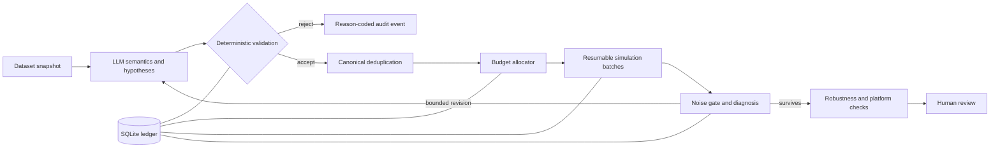

# Alpha Factory — LLM-Guided Alpha Research Under a Fixed Backtest Budget

Alpha Factory is a research system in which an LLM interprets field semantics, proposes hypotheses,
diagnoses failures, and suggests targeted revisions. Deterministic software controls validation,
deduplication, budgets, stopping rules, robustness checks, platform checks, and human-gated submission.

| Datasets | Available fields | Research ideas | Backtests | Best observed Sharpe |
|---:|---:|---:|---:|---:|
| **3** | **1,369** | **102** | **523** | **1.83** |

| Early-stopped at noise gate | Entered diagnosis/refinement | Refinement backtests | Complete acceptances |
|---:|---:|---:|---:|
| **59 (57.8%)** | **32** | **126** | **0** |

> Current-version research evidence. The best observed Sharpe is not a claim of tradability or
> platform acceptance; no candidate has passed the complete regular-alpha acceptance criteria.

## Table of Contents

1. [Overview](#overview)
2. [Results / Evidence](#results--evidence)
3. [Method](#method)
4. [System Design](#system-design)
5. [Representative Experiments](#representative-experiments)
6. [Technical Implementation](#technical-implementation)
7. [Repository Structure](#repository-structure)
8. [Limitations](#limitations)
9. [Current Status](#current-status)

## Overview

**Problem.** LLM-driven research can waste a limited backtest budget on invalid, duplicated, noisy,
or weakly revised ideas.

**What I built.** Alpha Factory turns semantic proposals into a traceable research workflow. It
admits only valid candidates, assigns bounded simulation budget, records every decision, and uses
measured failures to direct limited refinement.

**Why it matters.** The system separates creative reasoning from execution authority: the LLM may
suggest; deterministic controls decide what is tested and when research stops.

## Results / Evidence

### Research funnel

| Stage | Current-version record |
|---|---:|
| Available search space | 3 datasets; 1,369 fields |
| Ideas generated | 102 |
| Total backtests | 523 |
| Ideas stopped at the early noise gate | 59 (57.8%) |
| Ideas entering diagnosis/refinement | 32 |
| Refinement backtests | 126 |

### Best-Sharpe distribution

Threshold counts are nested; each row includes ideas above the higher thresholds.

| Best observed Sharpe per idea | Ideas |
|---:|---:|
| >= 0.8 | 43 |
| >= 1.0 | 31 |
| >= 1.2 | 19 |
| >= 1.5 | 6 |
| Maximum observed | **1.83** |

These records demonstrate budget allocation, filtering, and refinement behavior. They do not show
that an LLM outperforms another search method, and they do not establish out-of-sample value.

## Method

1. **Freeze the research scope.** Load a dataset snapshot and its available field metadata.
2. **Interpret semantics.** Group fields by economic meaning and construct testable hypotheses.
3. **Generate bounded candidates.** Produce a small, typed set of distinct proposals.
4. **Validate before simulation.** Reject unknown inputs, invalid operator use, excess complexity,
   policy violations, and duplicates locally.
5. **Allocate budget.** Admit candidates in resumable batches under daily, dataset, and refinement
   limits.
6. **Stop weak paths early.** Use a noise gate to prevent unproductive ideas from absorbing further
   budget.
7. **Diagnose and revise selectively.** Allow bounded, evidence-linked changes to surviving ideas.
8. **Run robustness and platform checks.** Record all outcomes and stop at human review.

## System Design



| LLM responsibility | Deterministic responsibility |
|---|---|
| Interpret field descriptions | Verify fields, types, operators, and settings |
| Form economic hypotheses | Canonicalize and deduplicate candidates |
| Generate candidate structures | Enforce budgets, pacing, retries, and stop rules |
| Diagnose measured failures | Persist lineage, results, and reason-coded decisions |
| Suggest targeted revisions | Apply robustness checks and require human submission approval |

See [architecture](docs/ARCHITECTURE.md) and
[technical design](docs/TECHNICAL_DESIGN.md).

## Representative Experiments

| Experiment | What the system did | Evidence retained |
|---|---|---|
| Early-noise termination | Stopped 59 of 102 ideas before further refinement | Stop reason and budget usage |
| Diagnosis-driven refinement | Advanced 32 ideas and ran 126 targeted refinement backtests | Parent-child lineage and diagnosis |
| High-end candidate review | Identified 6 ideas with best observed Sharpe >= 1.5 | Full gate trail; no acceptance claim |
| Sanitized offline replay | Exercised validation, persistence, routing, and reporting without external calls | Synthetic decision trace and report |

The public [sanitized replay](docs/case-studies/sanitized-replay.md) uses abstract identifiers and
synthetic metrics. It illustrates control flow only; it is not one of the recorded research ideas.

## Technical Implementation

- Python 3.11+, Pydantic contracts, SQLAlchemy, Alembic, Typer, and SQLite.
- Typed LLM responses fail closed when malformed or unsupported.
- Canonical fingerprints prevent equivalent candidates from spending budget twice.
- External work is recorded before polling, enabling restart-safe and idempotent execution.
- Failure classes distinguish validation, authentication, rate limit, timeout, transport, and
  platform-state outcomes.
- Promotion ends at human review; automatic submission is disabled.

| Verification | Result |
|---|---:|
| Automated tests | **247 passed, 5 skipped** |
| Statement/branch coverage | **85.22%** |
| Source files type-checked | **73** |
| Lint and formatting | Passed |
| External calls made by tests | **0** |

Details: [test evidence](docs/TEST_EVIDENCE.md),
[design tradeoffs](docs/DESIGN_TRADEOFFS.md), and
[60-second technical explanation](docs/60_SECOND_EXPLANATION.md).

## Repository Structure

```text
src/alpha_orchestrator/factory/   research state machine, gates, scheduler, ledger
src/alpha_orchestrator/adapters/  replay, fake, and authorized service boundaries
src/alpha_orchestrator/domain/    typed models, identity, errors, state transitions
src/alpha_orchestrator/storage/   database schema and repositories
tests/                            unit, integration, replay, and failure-path tests
examples/sanitized-replay/        abstract offline execution trace
docs/                             architecture, evidence, limits, and case study
policies/                         versioned budgets, routing, and risk controls
```

## Limitations

- No candidate has passed the complete regular-alpha acceptance criteria.
- Best observed Sharpe is an in-process research statistic, not proof of future performance.
- No controlled comparison establishes superiority over alternative search methods.
- The public replay is synthetic and cannot validate predictive quality.
- Live credentials, real field identifiers, expressions, alpha IDs, databases, and raw reports are
  intentionally excluded.

See [known limits](docs/KNOWN_LIMITS.md) and [NOTICE](NOTICE.md).

## Current Status

The current version is a working, test-covered research orchestrator with recorded budget-control
and refinement evidence. It has produced promising intermediate candidates, but **zero complete
acceptances**. The next research milestone is a candidate that passes the full regular-alpha gate;
submission remains human-controlled.

## License

MIT. Runtime dependencies remain under their respective licenses.
