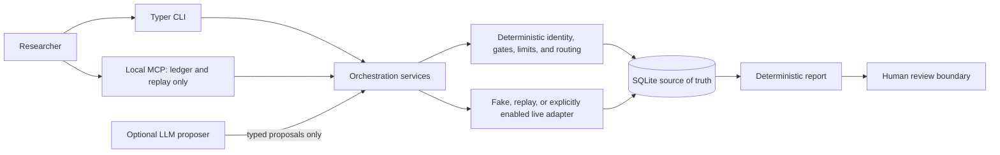

# Current Package Architecture

## Causal story

A researcher starts `alpha-lab` or a deliberately narrow local MCP tool. The interface borrows
deterministic application services rather than implementing research rules itself. Those services
connect to the SQLite ledger and one explicitly selected adapter, then produce persisted decisions
and a deterministic report. Any surviving candidate stops at human review; there is no submission
path.

## Authority boundaries

- The CLI is the full operator interface. Its live commands require separate configuration.
- MCP exposes ledger reads, replay execution, and a fixed stop action only. It cannot invoke the
  LLM, inspect arbitrary corpus paths, use the live adapter, approve cards, or submit an Alpha.
- The optional LLM can propose a new candidate or one single-parent repair. It cannot validate
  syntax, classify transport errors, alter limits, declare a platform pass, or submit.
- Deterministic services canonicalize candidate identity, deduplicate before simulation, validate
  structure, enforce ceilings, route results, classify external errors, and preserve lineage.
- Fake and replay adapters are offline. The live adapter is disabled without an external protected
  session-cookie file and performs at most one poll per execution.
- SQLite is the source of truth for the frozen run contract, candidates, events, decisions,
  attempts, snapshots, prompt hashes, LLM usage metadata, platform checks, and stop reason.

## Reconstruction path

`run create` freezes one dataset and `region x universe x delay` cell. Proposal events are
canonicalized into stable fingerprints. A new fingerprint becomes a candidate; a duplicate reuses
the existing record. Structural gates run before an adapter call. Each request has a stable
idempotency key, and each response or classified failure becomes an attempt row. Routing decisions
and state transitions are transactional. `run resume` reads unresolved work from SQLite, while
`report` reconstructs the experiment without relying on console history.

The architecture is single-process and local by design. It favors auditability and a small failure
surface over distributed throughput.
