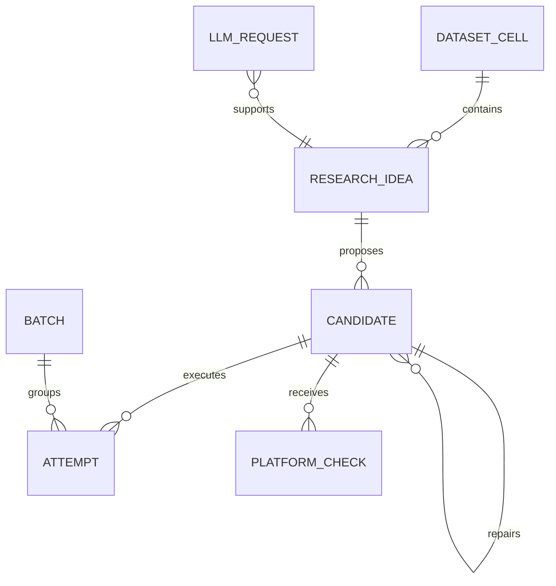

# Technical Design

## 1. Problem definition

LLM-generated research candidates are cheap to produce but expensive to simulate. The system must
therefore treat backtest requests as a scarce resource and make every transition reconstructable.
Alpha Factory separates probabilistic proposal generation from deterministic resource control.

The primary design objective is not “generate more formulas.” It is:

> maximize inspectable research throughput subject to fixed simulation, concurrency, retry, and
> human-review constraints.

## 2. Control-plane invariants

1. An LLM response never reaches the simulator without deterministic validation.
2. A canonical candidate identity is checked before budget is reserved.
3. A batch is persisted before dispatch and can be resumed after interruption.
4. Retry policy depends on failure class; research failures are not infrastructure retries.
5. Repair is bounded and linked to its parent candidate.
6. No candidate is submitted automatically.

## 3. State and data model



The ledger stores logical identity separately from execution attempts. This prevents a transient
transport failure from creating a second research candidate and lets retries retain provenance.

## 4. Candidate admission pipeline

```text
parse typed response
  -> verify every identifier against frozen metadata
  -> validate operator arity and argument types
  -> require vector reduction where applicable
  -> enforce complexity and policy limits
  -> canonicalize expression + settings
  -> reject duplicates
  -> reserve budget
  -> persist batch
  -> dispatch
```

Each rejection is reason-coded. The LLM can explain or propose a repair, but it cannot override a
failed gate.

## 5. Scheduling and recovery

The scheduler has explicit limits for daily simulations, per-dataset simulations, concurrent
slots, children per slot, minimum batch interval, and maximum repair rounds. Before an external
request, it commits the batch and attempt rows. On restart it reads unresolved rows and resumes
polling rather than recreating requests.

This is an at-least-once environment with application-level idempotency: canonical candidate keys
and persisted external request identifiers protect the budget from duplicate dispatch.

## 6. Failure semantics

| Failure class | Policy |
|---|---|
| invalid proposal | reject locally; spend zero simulation budget |
| authentication expiry | stop cleanly; require human re-authentication |
| rate limit | respect server pacing; bounded retry |
| timeout/transport | retry only within infrastructure policy |
| completed weak result | record research evidence; do not retry as infrastructure |
| malformed platform state | fail closed and retain raw reference for diagnosis |

Secrets are recursively redacted before structured errors are persisted.

## 7. LLM boundary

LLM calls use role-specific prompts and structured response contracts. The ledger records model,
role, token counts, prompt version, latency metadata, and outcome—not credentials. Deterministic
code owns field allowlists, formula parsing, budgets, state transitions, and final stopping.

## 8. Verification strategy

The public suite uses fake adapters, intercepted HTTP traffic, and deterministic replay fixtures.
Coverage includes:

- equivalent-expression deduplication;
- crash recovery and unresolved-batch resumption;
- rate-limit and near-expiry authentication behavior;
- malformed LLM payloads and secret redaction;
- migration compatibility and repository invariants;
- bounded repair lineage and human-review stopping.

The sanitized replay example runs the same orchestration and storage code used by other adapters,
but substitutes synthetic metadata and results. This demonstrates the system, not an alpha.

## 9. Deliberate tradeoffs

SQLite and a synchronous local worker prioritize auditability and operator control over horizontal
scale. A distributed deployment would require a transactional outbox, leases, and stronger
exactly-once semantics. Those costs are not justified for the current single-researcher workload.
